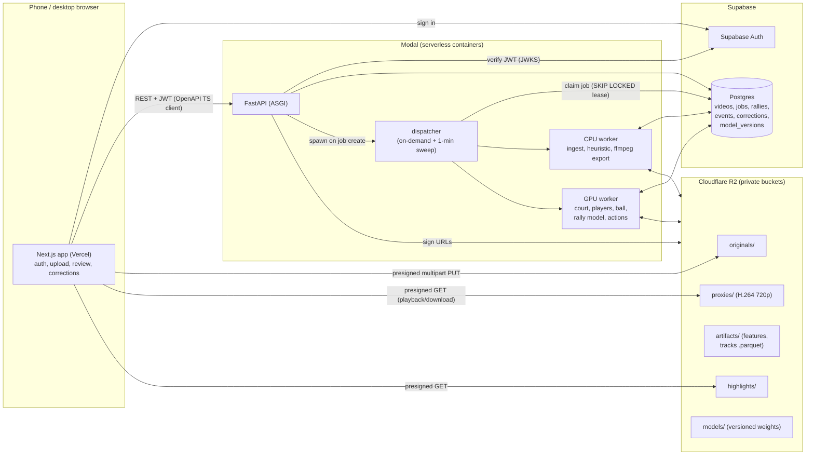

# VBall — Architecture

Status: **design document, nothing implemented yet.** Every capability below is a *target*
unless explicitly marked otherwise. No accuracy figure in this document is a measurement; all
numbers labelled "target" are acceptance thresholds to be validated against labelled data, and
all cost figures labelled "estimate" are planning assumptions to be replaced by measurements
taken in milestones M4, M8 and M12 (see `IMPLEMENTATION_PLAN.md`).

Contents

1. Audit of the old repository (`martinzukowski/vball`)
2. Gap analysis
3. Target system overview and diagram
4. Technology stack (with alternatives)
5. Data model
6. Job system
7. Video processing and ML inference pipeline
8. Machine learning: models, data, training, evaluation
9. Statistics: what can and cannot be derived
10. Video ingestion and YouTube
11. Security, privacy, observability
12. Cost model
13. Open risks

---

## 1. Audit of the old repository

Audited at commit `a6b001d` (2 commits total). Source read in full: `index.html`, `js/util.js`,
`js/calibrate.js`, `js/analyze.js`, `js/detect.js`, `js/review.js`, `js/export.js`, `js/app.js`,
`README.md`, `PROJECT_BRIEF.md` (the brief is the project prompt itself, not code).

### 1.1 How it actually works

It is a **single-page, build-free, browser-only app** ("Rally Cutter"). Plain scripts hang off a
global `window.VB` namespace; there is no framework, bundler, package manager, server, or test.

| Stage | File | What the code really does |
|---|---|---|
| Load | `app.js` | `URL.createObjectURL(file)` into a `<video>`. Project state saved to `localStorage` keyed by `filename:size`; optional JSON project export/import. |
| Calibrate | `calibrate.js`, `util.js` | User clicks 4 court corners. `VB.homography` solves an 8×8 linear system (Gaussian elimination) mapping court metres (9×18) to pixels. `VB.playArea` builds a convex hull of the court ±1.5 m, raised 3.2 m using local pixels-per-metre; rasterised to a 256×144 mask. Net and 3 m lines are drawn for visual verification. |
| Measure | `analyze.js` | Plays the video at 4× (muted) and on a 25 ms `setTimeout` loop samples every 0.2 s of video time: draws the frame to a 256×144 canvas, converts to grayscale, and computes `act` = fraction of masked pixels whose value changed by >16 vs the previous sample. Web Audio `AnalyserNode` records max dB in a 2–4.5 kHz "whistle" band and a 200–1500 Hz band. A 64×36 copy of the background (outside the mask) is compared with the calibration frame; a sustained median difference >18 for 3 s marks a camera move, waits for 2 s of stillness, pauses and asks the user to re-mark corners. |
| Detect | `detect.js` | Pure function (also loadable in Node). Resamples to a 0.2 s grid, smooths, computes per-camera quantile thresholds, finds whistles, finds "freezes" (motion below the 15th percentile for ≥0.8 s followed by a rise above 1.3× median within 3 s), anchors serves on whistles when ≥4 are found, else on freezes, ends a rally when motion stays below the 30th percentile for 0.8 s, enforces ≥7 s between points, pads 2 s before / 1 s after. If too few rallies are found, falls back to hysteresis on motion level. The `score` shown per rally is normalised mean motion, **not a probability**. |
| Edit | `review.js` | Canvas timeline (ruler, motion curve, whistles, camera moves), DOM clips with drag handles, thumbnails via a second hidden `<video>`, "skip dead time" playback, CSS-transform zoom to court, keyboard shortcuts. A "Fewer/More" slider re-runs `detectRallies` with shifted parameters on stored features. |
| Export | `export.js` | CSV; a Windows `.bat` that runs `ffmpeg -c copy` per rally then concat (keyframe-snapped cuts); in-browser highlight recording via `canvas.captureStream` + `MediaRecorder`, played back in real time. |

### 1.2 Classification of functionality

| Functionality | Status |
|---|---|
| Manual 4-corner calibration, homography, play-area mask | **Implemented** (code present; no tests) |
| Motion/whistle/camera-move measurement in browser | **Implemented**, but non-deterministic (see 1.3) |
| Heuristic rally detection with fallback | **Implemented** (pure function, portable) |
| Timeline editor, trimming, add/delete, keyboard UX | **Implemented** |
| CSV / ffmpeg script / MediaRecorder export | **Implemented** |
| "Measured on real match footage, this beats overall motion level" | **Documented but unverified** — no dataset, labels, benchmark or results are in the repo |
| "Different gyms, lenses and camera heights work without tuning" | **Documented but unverified** |
| iPhone HEVC / 4K support | **Documented but unverified**, and browser-dependent |
| Rotation stats (Phase 2 roadmap) | **Missing** |
| Ball tracking via WebGPU (Phase 3 roadmap) | **Missing** |
| Player detection/tracking, actions, statistics, ML of any kind | **Missing** |
| Accounts, server, database, cloud storage, job queue | **Missing** |
| Tests of any kind | **Missing** (0 test files, 0% coverage) |

### 1.3 Weaknesses

Architectural

- **All compute is on the user's device**, in a foreground tab. Analysis takes about ¼ of match
  length and pauses when the tab is backgrounded (by design, `analyze.js` tick throttling logic).
  This directly contradicts the core requirement.
- **Non-reproducible measurement.** Samples are taken when a timer fires during real-time 4×
  playback, so the exact frames sampled depend on machine speed, decoder hiccups and tab
  throttling. Two runs on the same file can produce different features and rallies. A server
  pipeline must decode deterministically (fixed frame timestamps).
- **Audio is tied to playback rate** (Chrome mutes audio above 4×, noted in code), so whistle
  detection only works because analysis is capped at 4×.
- **State is per-browser** (`localStorage`, keyed by filename+size — collisions are possible and
  nothing syncs across devices).
- **Export is real-time** (MediaRecorder) or Windows-only (`.bat`), and stream-copy cuts snap to
  keyframes.
- Global-namespace scripts, no types, no modules, no tests, no CI.

Algorithmic

- It is **frame differencing with hand-tuned thresholds** (`DEFAULTS` in `detect.js`: 16 grey
  levels, 15th/30th/50th percentiles, 0.8 s, 7 s, 35 s max rally…). These encode one person's
  observations on unspecified footage. There is no ground truth to know how often it is wrong.
- **Quantile thresholds assume a typical proportion of rally vs downtime** in each video. Footage
  that is mostly rallies (trimmed video) or mostly downtime (long warm-ups) shifts every threshold.
- The 2-frame-difference signal at 0.2 s spacing cannot distinguish players walking from players
  playing (the README admits this), cannot see the ball, and is sensitive to lighting flicker,
  people walking in front of the camera, and spectators inside the raised play-area hull.
- `maxRally: 35` s silently truncates long rallies; `minDead: 7` s merges quick re-serves.
- Confidence (`score`) is not calibrated and cannot drive a "needs review" UI honestly.
- Requires manual calibration before anything happens.

Performance bottlenecks

- `getImageData` + per-pixel JS loops per sample on the main thread; full-video playback is the
  real cost (decode at 4× of a 4K HEVC file is heavy on weak laptops/phones).
- Thumbnails seek a second `<video>` serially.

### 1.4 Reuse vs replace (decision: new repository, no code carried over verbatim)

You have decided to start a new repository. That is justified: nothing in the old code is
structured for a server, the language changes for processing (JS → Python), and the UI must be
rebuilt in a component framework for mobile. What we keep are **ideas, UX patterns and one
reference implementation**:

| Old asset | Decision | Justification |
|---|---|---|
| `detect.js` heuristic | **Port to Python as `heuristic-v1` baseline**, labelled as a heuristic everywhere. Keep the original JS as a golden reference for a parity test. | It is the only working rally detector we have; it becomes the baseline every ML model must beat, a feature source, and the Phase 1 detector. |
| `analyze.js` signals (masked frame diff, whistle band energy, background-change camera-move detection) | **Re-implement** in the worker with deterministic ffmpeg decoding at fixed timestamps; audio extracted separately at full rate. | Same signals, made reproducible and device-independent; also reused as hand-crafted input features to the ML rally model. |
| `util.js` homography, play-area hull, crop box | **Re-implement** with OpenCV/NumPy (`cv2.findHomography`), add unit tests. Same court model (9×18 m, net at 9 m, attack lines at 6/12 m). | Geometry is correct in principle; we need RANSAC, >4 points, and reprojection-error confidence. |
| `calibrate.js` corner-marking UX (out-of-frame corners, net line preview) | **Rebuild in React** with touch support; becomes the manual fallback/correction for the court model. | Good UX, required as low-confidence fallback. |
| `review.js` timeline UX (clips, drag trims, skip-dead-time, zoom-to-court, shortcuts) | **Rebuild in React** as the rally review/correction UI, touch-first. | Core editing UX is the correction/labelling tool for Phase 2. |
| `export.js` MediaRecorder / `.bat` | **Replace** with server-side ffmpeg highlight jobs. | Real-time, device-bound, Windows-only. |
| `localStorage` project model | **Replace** with Postgres. | Cross-device, durable, multi-user. |

---

## 2. Gap analysis

| Capability | Old repo | Target | Gap |
|---|---|---|---|
| Hosting | Static file opened locally | Next.js on Vercel + API + workers | Entire platform |
| Auth | None | Supabase Auth, per-user authorisation | New |
| Upload | Local file only | Resumable direct-to-R2 multipart, MP4/MOV | New |
| Processing location | User's browser, foreground | Cloud workers, device-independent | New |
| Reproducibility | Timer-driven sampling | Deterministic decode, versioned pipeline | New |
| Court calibration | Manual 4 corners | Keypoint model + homography + manual fallback | Model new; manual UX rebuilt |
| Rally detection | Heuristic | Trained temporal model, calibrated confidence, heuristic baseline | Model, data, eval new |
| Player detection/tracking | None | Fine-tuned detector + ByteTrack, team assignment | New |
| Ball tracking | None | Heatmap ball model + trajectory reconstruction | New |
| Action recognition | None | Contact spotting + classification with grammar | New |
| Statistics | None (rotation stats planned) | Event-derived stats with explicit provenance | New |
| Corrections → training data | Edits saved locally only | Immutable predictions + correction layer + dataset versions | New |
| Evaluation | None | Benchmark harness, held-out venues, CI regression | New |
| Highlights | MediaRecorder / `.bat` | Server-side ffmpeg, downloadable from any device | Rebuilt |
| Tests / CI / observability | None | Unit, integration, E2E, ML eval, logs, metrics, Sentry | New |

---

## 3. Target system overview



Key properties

- **Large files never pass through Vercel or the API.** Browser uploads straight to R2 with
  presigned multipart URLs; playback/download use short-lived presigned GETs.
- **Postgres is the source of truth for jobs.** The queue is a table with leases; Modal is only
  the compute. The worker image also runs as a plain polling loop on any Docker host (RunPod,
  Fly, a VM), so we are not locked into Modal.
- **Every result row references an `analysis_run`**, which references the exact
  `pipeline_version` and `model_version`s used.
- **Predictions are immutable**; user corrections are stored as a separate layer.

---

## 4. Technology stack

Each choice lists the main alternatives and why they lost.

| Concern | Choice | Alternatives considered | Why |
|---|---|---|---|
| Frontend | **Next.js (App Router) + TypeScript + Tailwind + shadcn/ui**, on Vercel | SvelteKit; Vite SPA on Cloudflare Pages; port old vanilla JS | You asked for Vercel/Next. Old UI has no reusable component structure, so migration cost from vanilla JS ≈ rebuild either way. Next gives SSR for auth-gated pages and first-class Vercel deployment. |
| API client | **openapi-typescript + openapi-fetch**, generated from FastAPI's OpenAPI | Hand-written fetch; tRPC (TS-only backend) | Type-safe contract across Python/TS; regenerated in CI with drift check. |
| Backend | **Python 3.12, FastAPI, Pydantic v2, SQLAlchemy 2 (async), Alembic** | Django + DRF; Node/Nest | Same language as ML/worker so domain code and schemas are shared; FastAPI emits OpenAPI natively. |
| API hosting | **Modal ASGI app** (scale to zero), same Docker image definition as workers | Google Cloud Run; Fly.io; Vercel Python functions; Render | Keeps vendors to 4 (Vercel, Supabase, R2, Modal). API is stateless and containerised, so moving to Cloud Run/Fly is a config change. Cold starts of a slim image are acceptable for a personal app; set `min_containers=1` later if not. Vercel Python functions were rejected to keep all Python on one platform with shared images. **Decision point for you** (B6). |
| Database | **Supabase Postgres** | Neon; RDS; self-hosted | Bundled Auth, generous free tier, plain Postgres (portable). Free projects pause after ~1 week inactivity and cap DB at 500 MB → fine for dev, move to Pro ($25/mo) for real use. |
| Auth | **Supabase Auth** (email magic link + Google/Apple OAuth); API verifies JWTs via JWKS | Clerk; Auth.js; Cognito | Same vendor as DB, free tier, mobile-friendly. API enforces authorisation itself; RLS is enabled deny-by-default as defence in depth (browser never queries Postgres directly). |
| Object storage | **Cloudflare R2** | S3; Backblaze B2; Supabase Storage | Zero egress (video playback is egress-heavy), S3 API, multipart uploads, lifecycle rules, 10 GB free. |
| Queue | **Postgres job table** (`FOR UPDATE SKIP LOCKED`, leases, heartbeats) | Redis/RQ/Celery (Upstash); SQS; Modal queues alone; Temporal | No extra service, transactional with results, inspectable with SQL, adequate for far more than our throughput. Temporal is excellent but heavy for this scale. |
| Compute | **Modal** for CPU and GPU workers (per-second billing, scale to zero, $30/mo free credit on Starter, T4 ≈ $0.59/h, L4 ≈ $0.80/h per Modal's pricing page as of Nov 2026) | RunPod Serverless; Replicate; AWS Batch; Hetzner VM; Lambda | Lowest idle cost with real GPUs and fast cold starts; Python-native deployment. GPU instances are preemptible → pipeline checkpoints per stage. RunPod is the fallback provider (same Docker image + polling loop). |
| Video tooling | **ffmpeg/ffprobe** (CLI, pinned static build), **PyAV** for frame-accurate decoding | OpenCV VideoCapture; decord; NVDEC via PyNvVideoCodec | ffprobe for validation/metadata, PyAV for deterministic timestamp-addressed decode. GPU decode (NVDEC) is an optimisation in Phase 5. |
| ML framework | **PyTorch**, exported to **ONNX** (ONNX Runtime GPU/CPU) for inference where it helps | TensorRT (Phase 5); JAX | Ecosystem; ONNX decouples training env from inference image. |
| Object detection | **RF-DETR (Apache-2.0 sizes N–L)** fine-tuned | Ultralytics YOLO11/YOLO26 (**AGPL-3.0**, or paid licence); YOLOX (Apache); D-FINE (Apache) | AGPL would oblige you to publish the source of a network service using it, or buy a licence. RF-DETR is permissive and current. YOLOX/D-FINE are fallbacks. Verify the licence of the exact size used (larger RF-DETR sizes are under a different Roboflow licence). |
| Tracking | **ByteTrack** (MIT, via `supervision`, MIT) | BoT-SORT/BoxMOT (AGPL), OC-SORT, DeepSORT | Permissive, strong, simple. Re-ID appearance features added later if IDF1 demands it. |
| Ball | **WASB** (nttcom/WASB-SBDT, includes a volleyball setting) and **TrackNetV3** (MIT) as candidates, fine-tuned | Generic detector on tiles; TrackNetV4 | Heatmap models over stacked consecutive frames are designed for small fast blurred balls; a generic detector alone is not expected to be adequate (to be shown in the Phase 3 benchmark). Confirm WASB licence file before use. |
| Frame embeddings | **DINOv2 ViT-S/14** (Apache-2.0 code and weights) | CLIP; VideoMAE; X3D/SlowFast | Strong frozen features at low cost; compute once per video, then a tiny temporal model learns rally structure from little data. Video transformers are heavier and need more labelled data; reconsider if the TCN plateaus. |
| Pose (Phase 4) | **RTMPose** (MMPose, Apache-2.0) | YOLO-pose (AGPL); ViTPose | Permissive, fast. |
| Experiment tracking | **MLflow** (local file/SQLite backend, artifacts in R2) | Weights & Biases (free personal tier); none | No hosted service needed; can switch to W&B if you prefer its UI (B9). |
| Labelling | **CVAT** (MIT; self-host via Docker or cvat.ai free tier) for boxes/keypoints/ball points; **our own timeline UI** for rally boundaries and action timestamps | Label Studio; Roboflow annotate | CVAT handles video interpolation for boxes/points well; rally/action labels are far faster in a purpose-built timeline. |
| Python tooling | **uv** workspace, ruff, mypy (strict on core), pytest | Poetry; pip-tools | Fast, lockfile, workspaces. |
| JS tooling | **pnpm**, ESLint, Vitest, Playwright | npm; Jest; Cypress | Standard. |
| Observability | **structlog** JSON logs, **Sentry** (free tier) for web/API/worker, per-stage job metrics in Postgres | Datadog; Grafana Cloud; OTel collector | Cheap; job-stage metrics double as our cost measurements. OTel tracing can be added later. |
| CI/CD | **GitHub Actions**; Vercel Git integration; `modal deploy` on main | CircleCI | Standard. |
| LLMs | **None in the analysis path.** Optional later: natural-language Q&A over verified stats only | — | Per requirements. |

---

## 5. Data model (Postgres)

Bulk per-frame data (tracks, ball trajectories, embeddings) lives in R2 as Parquet/NPZ and is
referenced by URI + sha256; Postgres holds entities, segments and events.

```
profiles(id = auth.users.id, display_name, created_at, quota_storage_bytes, quota_minutes_month)

teams(id, owner_id, name, color_hex)
players(id, team_id, name, jersey_number, position)
matches(id, owner_id, home_team_id, away_team_id, played_on, venue, level, notes)
match_sets(id, match_id, set_number, video_id, start_t, end_t, home_score, away_score, source)

videos(id, owner_id, match_id?, status{uploading,uploaded,ingesting,ready,failed,deleted},
       original_key, proxy_key, poster_key, filename, size_bytes, sha256,
       duration_s, fps_num, fps_den, width, height, rotation, video_codec, audio_codec,
       container, recorded_at?, created_at, deleted_at)
uploads(id, video_id, r2_upload_id, part_size, parts_completed, expires_at)   -- multipart state

processing_jobs(id, video_id, owner_id, kind{ingest,analyze,redetect,highlight,...},
       idempotency_key UNIQUE, params jsonb, pipeline_version,
       state{queued,running,succeeded,failed,cancelled}, stage, progress real,
       attempt, max_attempts, run_after, lease_owner, lease_expires_at, heartbeat_at,
       error_code, error_message, created_at, started_at, finished_at)
job_stage_metrics(job_id, stage, started_at, finished_at, wall_s, cpu_s, gpu_s,
       peak_mem_mb, frames_processed, worker_kind, instance_type)

model_versions(id, task{court,player_det,ball,rally,action}, name, version, artifact_uri, sha256,
       framework, input_spec jsonb, training_dataset_version_id, metrics jsonb,
       status{candidate,production,retired}, created_at, promoted_at, promoted_by)
analysis_runs(id, video_id, job_id, pipeline_version, model_version_ids uuid[],
       params jsonb, status, created_at, is_active)   -- one active run per video

camera_segments(id, analysis_run_id, start_t, end_t, source{manual,model},
       image_keypoints jsonb, homography float8[9], reprojection_err_px, confidence)
rallies(id, analysis_run_id, video_id, start_t, end_t, serve_t?, confidence,
       detector{heuristic-v1, rally-tcn-vN}, serving_side?, set_id?)
events(id, analysis_run_id, rally_id, type{serve,reception,set,attack,block,dig,freeball,...},
       t, confidence, track_id?, player_id?, team_side?, court_x?, court_y?)
tracks(id, analysis_run_id, kind{player,ball}, track_key, start_t, end_t, team_side?,
       player_id?, identity_confidence?, data_uri, data_sha256)

-- corrections layer (predictions above are never mutated)
rally_edits(id, video_id, user_id, base_rally_id?, op{add,delete,modify}, start_t, end_t,
       created_at, superseded_by?)
event_edits(...same pattern...)
calibration_edits(...)
label_reviews(id, edit_table, edit_id, reviewer_id, verdict{accepted,rejected}, reviewed_at)
dataset_versions(id, task, name, manifest_uri, manifest_sha256, split_spec jsonb,
       source_query jsonb, created_at, frozen bool)

highlight_exports(id, video_id, owner_id, job_id, rally_ids uuid[], options jsonb
       {crop_to_court, resolution, include_padding}, output_key, size_bytes, status, expires_at)
```

The "effective" rallies the UI shows = active run's predictions with `rally_edits` applied (a SQL
view). Stats are computed from effective events, and each stat carries provenance
(model / user-confirmed / manual).

---

## 6. Job system

State machine: `queued → running → succeeded | failed | cancelled`, with retryable failures
returning to `queued` (`attempt+1`, exponential `run_after`) until `max_attempts`.

- **Creation** is idempotent: `idempotency_key = hash(video_id, kind, pipeline_version, params)`;
  re-submitting returns the existing job.
- **Dispatch:** the API, after committing the job row, calls a Modal function to spawn a worker
  (best-effort). A Modal cron every 60 s sweeps for `queued` jobs whose `run_after` has passed and
  `running` jobs with expired leases (crash/preemption recovery), so a lost spawn delays a job by
  at most a minute.
- **Claim:** `UPDATE … SET state='running', lease_owner=$w, lease_expires_at=now()+'5 min'
  WHERE id = (SELECT id … WHERE state='queued' AND run_after<=now() ORDER BY created_at
  FOR UPDATE SKIP LOCKED LIMIT 1) RETURNING *`.
- **Heartbeat** every 30 s extends the lease and writes real progress (frames processed / total).
  If a heartbeat finds the job cancelled, the worker stops.
- **Stage checkpoints:** each stage writes its artifact to R2 under
  `artifacts/{video_id}/{run_id}/{stage}.{ext}` with a sha256 recorded in the job's params;
  a retried job skips stages whose artifacts already exist and verify.
- **Commit:** results are inserted and the job marked `succeeded` **in one transaction**, only
  after output validation (schema check, rallies within duration, non-overlapping, finite
  values). There is no code path that marks a job succeeded without results; an empty result
  (e.g. zero rallies) is a valid but explicitly flagged outcome.
- **Concurrency limits:** per-user (1 analyze job at a time by default) enforced at claim; global
  via Modal `max_containers`.
- **Errors** are classified: `input_invalid` (not retryable, user-visible message),
  `transient` (retry), `internal` (retry then fail, alert Sentry).

---

## 7. Video processing and inference pipeline

```mermaid
flowchart TD
  A[Upload complete] --> B[ingest job: ffprobe validate<br/>duration/size/codec limits, sha256]
  B --> C[Proxy: H.264 720p faststart + audio AAC<br/>poster + sprite thumbnails]
  C --> D[Deterministic decode<br/>fixed timestamps, e.g. 5 fps analysis stream<br/>+ full-rate stream for ball]
  D --> E[Court calibration per camera segment<br/>model keypoints → RANSAC homography<br/>camera-move detection → re-calibrate]
  E -->|low confidence| M[Flag segment: ask user<br/>for manual corners]
  E --> F[Feature extraction<br/>DINOv2 court-crop embeddings, motion signals,<br/>audio log-mel + whistle band]
  F --> G[Rally model TCN → per-step probabilities]
  G --> H[Temporal post-processing<br/>HMM/Viterbi with min durations → segments + confidence]
  E --> I[Player detection + ByteTrack]
  D --> J[Ball heatmap model → trajectory reconstruction]
  I --> K[Team side via homography; identity linking]
  J --> L[Contact spotting + action classification<br/>with rally grammar]
  K --> L
  H --> N[(Persist analysis_run, rallies, events, tracks)]
  L --> N
```



Phase 1 runs only A–D, manual calibration (entered in the UI before submission, corrected per
segment afterwards), the heuristic signals and `heuristic-v1` detection. Each later phase adds
boxes without changing the job framework. Stages are separate functions so CPU-only stages run
in the cheap CPU worker and GPU stages in the GPU worker.

Determinism: decoding uses PyAV with explicit PTS selection; models run in eval mode with fixed
seeds; outputs are reproducible for a given `pipeline_version` + `model_version`s (bit-exact
GPU determinism is not guaranteed, but results must match within tolerance; tested).

---

## 8. Machine learning

### 8.1 Public data and pretrained models (licences must be verified before use — M9 task)

| Resource | What it offers | Licence status (as found, Nov 2026) | Use |
|---|---|---|---|
| Volleyball dataset (Ibrahim et al., CVPR 2016 / PAMI; SFU) — 55 YouTube videos, 4,830 annotated frames, player boxes, 9 individual action + 8 group activity labels | Pretraining/eval for action classification | Code BSD-2; **dataset terms not found** — must check with authors/project page. Broadcast-style footage, unlike tripod gym footage. | Possible pretraining for actions only |
| WASB-SBDT volleyball setting (ball annotations adapted from an earlier volleyball dataset) | Ball detection benchmark + pretrained weights | Repo appears MIT; **underlying data terms unverified** | Ball model starting point |
| TrackNetV3 (qaz812345/TrackNetV3) | Ball/shuttle heatmap tracking code | MIT (per derivative model card; confirm) | Ball model candidate |
| Beach volleyball fine-tuned TrackNetV3 weights (Hugging Face `deadfast/beach-volley-vision-models`) | Volleyball-adapted ball weights | States MIT | Initialisation for indoor fine-tune |
| Roboflow Universe volleyball ball/action/court datasets | Small labelled image sets | Varies per dataset (some CC BY 4.0); check each page | Supplementary detector data |
| COCO-pretrained RF-DETR | Person detection | Apache-2.0 (sizes N–L) | Player detector initialisation |
| DINOv2 | Frame embeddings | Apache-2.0 | Rally model features |

Reference projects (read for ideas, not dependencies): `kairsato/Volleyball-Metrics` (MIT),
`josselinbuils/volleyball-stats` (AGPL — do not copy code), `nttcom/WASB-SBDT`.

**No public dataset matches our target domain** (amateur/club indoor volleyball, fixed tripod,
phone camera, full matches with rally boundaries). **The rally model must be trained mainly on
your footage.** That is unavoidable and is the critical path for Phase 2.

### 8.2 What you need to label (initial baseline; to be revised from learning curves)

| Task | Unit | Suggested starting amount | Effort notes |
|---|---|---|---|
| Rally boundaries (serve contact, ball dead) + pre-serve | Full matches | **≥20 matches for train/val from ≥6 venues, plus ≥5 held-out matches from venues not in training** | Fast in our timeline UI (start from heuristic output and correct). A match is on the order of 100–200 rallies. |
| Court keypoints | Frames, ≥1 per camera setup, plus frames after camera moves | ≥300 frames across ≥15 camera setups | 12 floor keypoints (4 corners, 2 centre-line ends, 4 attack-line ends — extended lines where occluded) + 2 net-post tops |
| Players (boxes, side, track IDs) | Clips | ≥30 clips × 20–30 s across ≥8 venues, CVAT interpolation | Includes far-side players, refs labelled separately |
| Ball (centre point, visibility flag) | Frames at full rate | ≥20,000 frames over ≥10 venues | Most expensive per minute; CVAT points with interpolation |
| Actions (contact time, type, player track) | Rallies | ≥1,500 rallies | Done after ball/player models exist, so labelling is assisted |

These are planning numbers from the size of comparable tasks, not guarantees; we will plot
learning curves (metric vs training matches) after M12 to decide whether more data is needed.

Splits are **by match**, and the test set is **by venue** (no test venue appears in training);
a camera-setup id and skill level are stored per video so results can be broken down.

### 8.3 Model designs

- **Rally detection (Phase 2).** Inputs at 5 fps: DINOv2-S embedding of the court crop (384-d),
  heuristic motion signals, audio features (log-mel bands + whistle band energy at 5 fps).
  Model: a multi-stage temporal convolutional network (MS-TCN style, ~1 M params) over the whole
  video, per-step classes `{downtime, pre_serve, rally}`, plus a boundary-offset head.
  Post-processing: Viterbi decoding of an HMM with minimum durations, then segment confidence =
  mean rally probability, calibrated with temperature scaling on the validation set.
  Alternatives: fine-tuning a video transformer end-to-end (more data and compute; considered if
  the TCN plateaus), pure heuristics (baseline), gradient-boosted trees over hand features
  (cheap second baseline, worth running for comparison).
- **Court (Phase 3).** Heatmap keypoint network (HRNet-W18 or an RTMPose-style head) predicting
  14 keypoints with visibility; homography by RANSAC over visible points; confidence from
  reprojection error and inlier count. Camera-move detection by background feature matching
  between sampled frames (ORB + homography drift); re-run keypoints on change. Multi-sport line
  clutter in gyms is the main expected failure mode → manual fallback stays.
- **Players.** RF-DETR fine-tuned (classes: player, referee, other person), ByteTrack, side
  assignment from homography (foot point vs net line), team identity = side + set number
  (sides switch between sets) + optional jersey colour clustering. **Temporary track IDs are not
  player identities**; persistent identity needs jersey number OCR (later) or user linking.
  Player-specific stats are disabled until identity IDF1 on the benchmark passes a threshold.
- **Ball.** WASB/TrackNetV3 at full frame rate on 3-frame stacks at reduced resolution, fine-tuned
  on our labels; trajectory reconstruction with outlier rejection, gap interpolation and
  parabolic segment fitting; per-point confidence. 3D trajectory is out of scope for monocular
  video unless later justified.
- **Actions (Phase 4).** Two steps: (1) contact spotting from ball trajectory discontinuities +
  player proximity + pose; (2) contact classification using a sequence model over the rally's
  contacts with a volleyball grammar (serve first; ≤3 contacts per side; block exception).
  Evaluated as temporal action spotting.

### 8.4 Training workflow

`ml/` is a separate package with: dataset manifests (JSONL listing video sha256, segment,
labels, split) stored in R2 and recorded in `dataset_versions`; deterministic preprocessing
(cached features keyed by video sha256 + extractor version); YAML configs (one per experiment);
seeded training; MLflow logging (params, metrics, artifacts); checkpoint upload to
`models/{task}/{version}/` with sha256; ONNX export with a numeric-equivalence test; and an
evaluation CLI that writes a JSON report.

Promotion is manual and gated: a candidate becomes `production` only if it beats the current
production model and the heuristic on the frozen test set by the margins in the acceptance
criteria, with no per-venue regression beyond a set tolerance. User corrections enter training
only via a new frozen `dataset_version` built from **reviewed** edits; nothing retrains or
redeploys automatically.

Training compute: Modal GPU (A10/L4) on demand, or your local GPU if it is NVIDIA (the old
README mentions AMD; PyTorch ROCm on Windows is limited, so local training on that card is not
assumed).

### 8.5 Evaluation

| Task | Metrics | Matching rule |
|---|---|---|
| Rally | Precision, recall, F1 at tIoU ≥ 0.5 and 0.7; mean tIoU of matched; median & p90 abs start/end error (s); false-positive rate per hour; missed-rally rate | Hungarian matching on tIoU |
| Court | Keypoint PCK at k px; homography reprojection error of GT points (court metres) | Per frame |
| Players | mAP@[.5:.95], AP50; tracking HOTA, IDF1, ID switches per minute | TrackEval |
| Ball | Precision/recall/F1 at ≤ d px; RMSE of localisation; trajectory continuity (fraction of visible frames covered) | Per frame |
| Actions | Spotting mAP at ±0.5 s / ±1 s; per-class P/R, macro F1, confusion matrix; player association accuracy | Tolerance windows |

All metrics are reported overall and broken down by venue, camera position, resolution,
lighting and level. A small labelled fixture set (a few minutes) runs in CI to catch
regressions; the full benchmark runs on demand on Modal and its report is attached to the
`model_versions.metrics` row. No accuracy number is published in the UI or docs unless it came
from this harness.

Acceptance targets (proposed; you may tighten/loosen — they are goals, not claims):

| Stage | Target on held-out venues |
|---|---|
| Heuristic baseline (M10) | Just *measured*, no target |
| Rally model promotion (M13) | F1@tIoU0.5 ≥ 0.95 and strictly better than heuristic; median start error ≤ 1.0 s, end error ≤ 1.5 s; no venue below 0.85 F1 |
| Court model | Reprojection error ≤ 0.3 m median on visible court; fallback triggered (not silent) when above 0.6 m |
| Player detection/tracking | AP50(player) ≥ 0.9; IDF1 ≥ 0.7 within a rally |
| Ball | F1 ≥ 0.8 at ≤ 4 px (at model input resolution) on visible-ball frames |
| Actions | Macro F1 ≥ 0.75 on contact type; any class below 0.6 is hidden or shown as "unverified" |

### 8.6 Low-confidence UX

Every rally/event/calibration carries a calibrated confidence. Items below a per-task threshold
(chosen on validation data) are marked "needs review" in the UI, and review queues sort by
uncertainty. Nothing uncertain is silently presented as fact.

---

## 9. Statistics: derivability

| Statistic | Derivable from | Needs beyond detection | Earliest phase |
|---|---|---|---|
| Rally count, durations, total playing time | Rallies | — | 1 (heuristic, labelled as such) |
| Which side served each rally | Serve location via homography + player positions, or ball origin | Calibration | 3 |
| Point winner | Rally-scoring rule: next rally's serving team won the previous rally | Last rally of each set needs manual input or score; sides switch between sets (set boundaries: long-break detection + user confirmation) | 3 |
| Serving runs, side-out %, score progression | Serving side + point winner | Which team is which side per set (user input once per set) | 3 |
| Rotation tracking / per-rotation side-out | Serve sequence | Starting lineup per set (manual) + substitutions (manual) | 3–4 |
| Attack attempts, blocks, digs, receptions | Action events | Trained action model passing acceptance | 4 |
| Kills, errors, aces | Action events + rally outcome attribution | Ball landing in/out from monocular video is ambiguous → user confirmation | 4 (assisted) |
| Player-specific anything | Events + persistent identity | Identity accuracy threshold, roster input | 4 |

Every stat shown in the UI carries provenance; stats that depend on unconfirmed low-confidence
inferences are visually marked.

---

## 10. Video ingestion and YouTube

- **Direct upload (core path):** Uppy (or a small custom uploader) using S3 multipart with
  presigned part URLs issued by the API; 64 MB parts, parallel 3–4, resumable after network loss
  or app switch by re-listing parts (`uploads` table). R2 bucket CORS limited to the app origin.
  Accept MP4/MOV (H.264/HEVC); validated by ffprobe on the server, not by extension. Default
  limits: 25 GB, 4 h (configurable, quota-bound).
- **Cloud imports:** Google Drive via the Google Picker + OAuth `drive.file` scope, server-side
  copy to R2 (later milestone). Dropbox Chooser similar.
- **YouTube:** YouTube's Terms of Service prohibit downloading content except where YouTube
  provides a download feature or the rights holder authorises it, and the YouTube Data API does
  not provide media files. We will **not** implement a scraper/downloader (yt-dlp etc.).
  Compliant alternatives: channel owners download their own originals from YouTube Studio (or
  Google Takeout) and upload them; or upload the source recording directly. A YouTube URL could
  later be stored as a *reference* for embedded playback of results, without frame access, but
  analysis requires the file.

## 11. Security, privacy, observability

- Secrets only in Vercel/Modal/GitHub secret stores; `.env.example` documents names; no
  credentials in the repo; pre-commit secret scan (gitleaks).
- API: Pydantic validation on every input, JWT verification via Supabase JWKS, ownership checks on
  every resource (tested), rate limiting per user/IP (slowapi or Modal-side), CORS locked to the
  frontend origin.
- R2 buckets private; presigned URLs expire in ≤ 1 h (playback) / ≤ 15 min (upload parts);
  keys namespaced by owner id; lifecycle rules: abort incomplete multipart uploads after 7 days,
  delete originals N days after successful ingest (default 30, user-configurable), highlights
  after 30 days unless pinned.
- Untrusted media: ffprobe validation first; ffmpeg pinned and updated; worker containers have
  no secrets except scoped DB role + R2 keys; per-stage timeouts and memory limits; no shell
  string interpolation of user data.
- Deletion: user can delete a video → DB rows soft-deleted, R2 objects deleted by a job.
- Observability: structured JSON logs with `job_id`/`video_id`/`user_id` correlation; Sentry for
  exceptions in all three tiers; `job_stage_metrics` for durations and resources; `/healthz`
  (liveness) and `/readyz` (DB + R2 reachability); alert on failed-job rate and queue age.

## 12. Cost model

### 12.1 Fixed monthly (published prices, Nov 2026; verify before committing)

| Service | Dev | Real personal use |
|---|---|---|
| Vercel | Hobby $0 (personal, non-commercial only) | $0, or Pro $20/mo if commercial |
| Supabase | Free $0 (500 MB DB, pauses after ~1 week idle) | Pro $25/mo (no pausing, 8 GB DB) |
| Cloudflare R2 | 10 GB-month free | $0.015/GB-month beyond; egress free |
| Modal | $30/mo free credits (Starter) | Usage beyond credits |
| Sentry, GitHub Actions | Free tiers | Free tiers |

### 12.2 Per-video compute (ESTIMATES — to be replaced by measurements)

Rates used: Modal CPU ≈ $0.0000131/core-s, memory ≈ $0.00000222/GiB-s, L4 ≈ $0.000222/s.

Assumptions that M4/M12 will measure: (a) 2-core software decode + downscale of 1080p H.264
runs 4–10× real time; (b) 720p proxy transcode runs 1–3× real time on 4 cores (much faster with
NVENC on a GPU; skip entirely when the source is already browser-playable H.264); (c) the full
Phase 3–4 GPU pipeline sustains 60–200 frames/s on an L4.

| Video length | Phase 1 (CPU: ingest + proxy + heuristic) | Phase 2 add-on (embeddings + TCN, GPU) | Phase 3–4 full pipeline (GPU) |
|---|---|---|---|
| 30 min | ≈ $0.03–0.10 | ≈ $0.01–0.03 | ≈ $0.08–0.25 |
| 60 min | ≈ $0.06–0.20 | ≈ $0.02–0.05 | ≈ $0.15–0.50 |
| 120 min | ≈ $0.12–0.40 | ≈ $0.04–0.10 | ≈ $0.30–1.00 |

Proxy transcoding, not analysis, is the dominant Phase 1 cost under these assumptions. At this
scale, the $30 monthly Modal credit is expected to cover dozens of match-hours per month, but
that is precisely what the measurements must confirm.

### 12.3 Storage per video (estimate)

Phone 1080p30 H.264 is commonly 10–17 Mbit/s (≈ 4.5–7.6 GB/hour); 4K is several times larger.
720p proxy at ~2.5 Mbit/s ≈ 1.1 GB/hour. With originals deleted after 30 days, steady state is
≈ 1.1 GB per match-hour kept → $0.017/month each. Uploading many GB over mobile data is the real
user-facing constraint; recommend recording 1080p and uploading on Wi-Fi.

## 13. Open risks

1. **Labelled data volume** is the main schedule risk for Phases 2–4.
2. **Gym line clutter** may make automatic court calibration unreliable in some venues.
3. **Ball tracking in amateur footage** (low resolution far side, cluttered backgrounds) may not
   reach targets; fall back to rally-level analytics only.
4. **Player identity** from a single wide camera may be insufficient for per-player stats.
5. **Free-tier limits** (Supabase pausing, Vercel non-commercial clause) mean "free" is for
   development; real use is roughly $25–45/month fixed plus usage.
6. **Licences** of public datasets are unverified; until verified they are used for internal
   experimentation only, not shipped weights.
