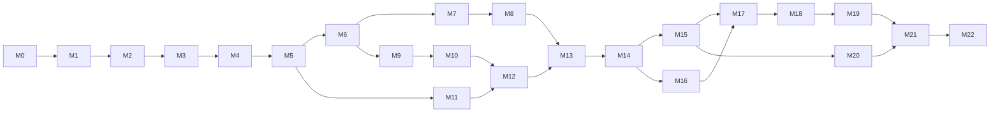

# VBall — Implementation Plan

Companion to `ARCHITECTURE.md`. Work proceeds in small milestones; each has dependencies,
tests and a verifiable acceptance criterion. A milestone is "done" only when its acceptance
criterion has been demonstrated, not when code exists.

Ground rules applied to every milestone

- No placeholder models, simulated predictions, fake progress or mock statistics in any
  user-facing path. Test fixtures and mocks live only in tests.
- Heuristic output is always labelled `heuristic-v1` in data and UI.
- No accuracy claim without a report from the benchmark harness.
- Every PR: lint, type-check, unit tests, OpenAPI client drift check.

---

## 1. Repository layout (new repo)

```
vball/                          (new GitHub repo; old repo archived read-only)
├── apps/
│   └── web/                    Next.js + TS (Vercel). app/, components/, lib/api (generated client)
├── services/
│   ├── api/                    FastAPI app: routers/, deps/ (auth, db), schemas/, services/
│   └── worker/                 job runner, stages/ (ingest, decode, calibrate, features,
│                               rally, players, ball, actions, export), modal_app.py, poll_main.py
├── packages/
│   └── vball_core/             shared Python: domain models, DB (SQLAlchemy) models, settings,
│                               geometry (homography, court model), storage (R2), job queue lib,
│                               heuristic-v1 detector
├── ml/
│   ├── datasets/               manifest builders, split logic, label importers (CVAT, app edits)
│   ├── features/               embedding/motion/audio extractors (shared with worker)
│   ├── rally/  court/  players/  ball/  actions/   train.py, model.py, configs/*.yaml
│   ├── eval/                   metrics, matching, benchmark CLI, report schema
│   └── export/                 ONNX export + equivalence tests
├── migrations/                 Alembic
├── infra/
│   ├── docker/                 worker.Dockerfile, api.Dockerfile, compose.yaml (Postgres + SeaweedFS S3 for local dev)
│   └── r2/                     bucket CORS + lifecycle JSON
├── tests/
│   ├── e2e/                    Playwright (web) against local stack
│   └── fixtures/               short licensed test clips + golden outputs
├── reference/
│   └── rally-cutter-js/        detect.js copied verbatim from old repo (golden reference only)
├── docs/                       labelling guidelines, runbooks, deployment, ADRs
├── .github/workflows/          ci.yml, deploy.yml, benchmark.yml
├── pyproject.toml (uv workspace)   pnpm-workspace.yaml   .env.example
├── ARCHITECTURE.md   IMPLEMENTATION_PLAN.md
```

Local development runs entirely in Docker Compose: Postgres, SeaweedFS (S3-compatible stand-in for
R2; MinIO no longer publishes community images), the API, a worker in polling mode, and `next dev`. Supabase Auth is the only external
dependency in dev (or the Supabase CLI local stack).

## 2. Migration strategy from the old repo

1. Archive `martinzukowski/vball` (read-only) after tagging `rally-cutter-final`; it stays usable
   locally as-is.
2. New repo starts empty. Only `js/detect.js` is copied, into `reference/`, purely to generate
   golden outputs for the Python port's parity test.
3. Features from the old UI are rebuilt deliberately in the order: review timeline → manual
   calibration → highlights. Nothing else is carried over.
4. Your existing edited rally projects (JSON exports from the old app, if you have any) can be
   imported as **labelled rally data** for Phase 2 — worth keeping.

---

## 3. Milestones

Legend: **Dep** = dependencies, **Tests**, **AC** = acceptance criterion.

### Phase 1 — Production cloud foundation

**M0 · Repo bootstrap and CI**
Monorepo skeleton, uv + pnpm workspaces, ruff/mypy/eslint/prettier, pre-commit (incl. gitleaks),
Docker Compose dev stack, GitHub Actions CI, `.env.example`, settings via pydantic-settings.
Dep: B1. Tests: CI runs empty test suites green. AC: `docker compose up` brings up Postgres +
S3 stand-in + API `/healthz` 200; CI green on a PR.

**M1 · Database schema and migrations**
SQLAlchemy models + Alembic migration for the schema in ARCHITECTURE §5 (Phase 1 subset first:
profiles, videos, uploads, processing_jobs, job_stage_metrics, analysis_runs, camera_segments,
rallies, rally_edits, model_versions, highlight_exports). RLS deny-all for anon/authenticated
roles. Dep: M0. Tests: migration up/down on a fresh DB; constraint tests (non-overlap check,
FKs, enums). AC: migrations apply cleanly to local Postgres and to Supabase.

**M2 · Authentication and authorisation**
Supabase Auth in web (magic link + Google); API dependency verifying JWT via JWKS and loading
the profile; ownership guard helpers. Dep: M1, B2. Tests: valid/expired/forged tokens;
cross-user access denied on every resource route (parametrised test). AC: sign-in works on phone
browser; API rejects requests without a valid token.

**M3 · Direct uploads to R2**
API endpoints: create upload (validates declared size/type against quota) → presigned multipart
part URLs → complete → enqueue ingest. Web uploader with resume after reload/network loss and
real byte progress. R2 CORS + lifecycle config. Dep: M2, B3. Tests: integration against the local S3 stand-in
(multipart create/complete/abort, resume by listing parts); quota rejection; E2E upload of a
small fixture. AC: a ≥2 GB file uploads from a phone over Wi-Fi, survives switching apps
mid-upload, and appears as `uploaded`.

**M4 · Job system + ingest worker**
`vball_core.jobs` (enqueue idempotent, claim with SKIP LOCKED lease, heartbeat, retry/backoff,
cancel, sweep), worker runner with stage checkpoints, Modal app (dispatcher, cron sweep,
CPU worker) and a plain polling entrypoint. Ingest stage: ffprobe validation, sha256, metadata,
720p H.264 proxy (skip/remux when source is already suitable), poster + timeline sprites.
`job_stage_metrics` recorded. Dep: M3, B4. Tests: unit tests for state transitions; concurrency
test (N workers, M jobs, each job processed exactly once); crash test (kill worker mid-stage →
lease expires → job resumes from checkpoint); invalid input (non-video, truncated MP4, zero
duration) → `failed` with `input_invalid`, never `succeeded`. AC: uploaded phone video (H.264 and
iPhone HEVC) is ingested remotely; proxy plays in mobile Safari and Android Chrome; **measured**
wall time / CPU-s per minute of video recorded for 3 sample videos (replaces ARCHITECTURE §12
Phase 1 estimates).

**M5 · Heuristic rally baseline (`heuristic-v1`) in the worker**
Deterministic signal extraction (masked frame-diff at 5 fps from PyAV, audio whistle/low bands
from the full-rate audio track, background camera-move detection producing camera segments) and
a Python port of `detectRallies`. Features stored as an artifact so "re-detect with sensitivity"
is a cheap server job. Dep: M4. Tests: **parity test** — feed identical feature arrays to the
original `detect.js` (run under Node in CI) and the Python port, rallies must match within 0.01 s;
geometry unit tests (homography round trip, play-area hull); determinism test (same video twice
→ identical features). AC: a full match processed in the cloud yields rallies labelled
`heuristic-v1`, reproducibly.

Note: because measurement is now deterministic and sampled differently from the browser,
results will differ from the old app on the same video. That is expected; M10 measures the
heuristic properly.

**M6 · Web app: library, job status, manual calibration, review timeline**
Pages: video library (status chips from real job state), video detail with real progress (from
heartbeats), touch calibration overlay on poster frame (out-of-frame corners, net/attack line
preview), rally list + timeline with clips, trim handles, add/delete, skip-dead-time playback,
zoom-to-court, per-camera-segment recalibration prompts. Edits saved as `rally_edits`. Generated
TS client. Dep: M2, M5. Tests: Vitest for timeline math/edit reducer; Playwright E2E (upload
fixture → job completes on local stack → edit a rally → reload on another browser context →
edit persists). AC: on a phone, review and correct rallies of a processed match comfortably;
low-confidence/camera-moved segments are flagged.

**M7 · Server-side highlights**
Highlight job: frame-accurate re-encode of selected rallies (from original if still present,
else proxy), optional crop to court, concat, upload to R2, signed download link, expiry.
Dep: M4, M6. Tests: output duration equals sum of clip durations ± 1 frame per clip;
ffprobe-valid output; cancelled/failed export never shows a download link. AC: select rallies on
phone → close browser → return later → download highlights MP4.

**M8 · Deployment + observability + Phase 1 acceptance**
Vercel project (preview + prod), Modal deploy from CI, Supabase prod project, R2 prod buckets,
Sentry in all tiers, structured logs, `/readyz`, alerting on failed-job rate and queue age,
deployment runbook in `docs/`. Dep: M0–M7, B1–B5. Tests: smoke E2E against the deployed preview.
**Phase 1 AC:** with your PC off, from your phone: sign in → upload a real match → close the
browser → return → see `heuristic-v1` rallies → correct some → export highlights → download.
Measured per-video cost for 30/60/120-minute files documented (replaces estimates).

### Phase 2 — Reliable ML rally detection

**M9 · Labelling workflow and dataset versioning**
Labelling guidelines (`docs/labelling/rallies.md`: exact definitions of serve start = server's
toss or contact, rally end = ball dead/whistle, pre-serve window, replays/let serves, timeouts).
"Label mode" in the review UI (full pass, marks video as `labelled` with reviewer). Review of
edits (`label_reviews`). Dataset builder: frozen manifest of accepted labels with split by match
and held-out venues. Importer for old-app project JSON. Licence check of public datasets
(ARCHITECTURE §8.1) recorded in `docs/data-licences.md`. Dep: M6, B7. Tests: split builder never
places a match or test venue in two splits; manifest hashing reproducible. AC: dataset v1 frozen
with ≥20 train/val matches and ≥5 held-out-venue test matches (or as many as available, with the
shortfall stated).

**M10 · Benchmark harness + heuristic baseline numbers**
`ml/eval` metrics (ARCHITECTURE §8.5), Hungarian tIoU matching, per-venue breakdown, JSON +
Markdown report, CI fixture benchmark. Dep: M9. Tests: metric unit tests against hand-computed
cases. AC: **first real measured numbers** for `heuristic-v1` on the test set, published in
`docs/benchmarks/`.

**M11 · Feature extraction at scale**
DINOv2-S court-crop embeddings at 5 fps, audio features, motion features, cached by
`(video sha256, extractor version)` in R2; GPU worker on Modal. Dep: M5, M9. Tests: extractor
determinism within tolerance; cache key invalidation on version bump. AC: features for all
dataset videos; GPU seconds per video-minute measured.

**M12 · Train rally model**
MS-TCN + HMM post-processing + temperature calibration; MLflow tracking; configs; baselines also
trained (gradient-boosted trees on hand features); learning curve over number of training
matches; ONNX export with equivalence test. Dep: M10, M11, B8. Tests: overfit-a-tiny-set test;
export equivalence; seeded reproducibility. AC: test-set report vs heuristic, with per-venue
results and calibration plot.

**M13 · Integrate, shadow, promote**
Worker runs the production rally model (and heuristic in shadow for comparison); confidence
drives "needs review"; promotion CLI enforcing the gates in ARCHITECTURE §8.5; `model_versions`
registry used by the worker. Dep: M12. Tests: worker refuses unregistered/hash-mismatched model
artifacts; promotion refused when gates fail. **Phase 2 AC:** a trained, evaluated rally model
runs in the cloud with documented performance on unseen venues, meeting the targets — or, if it
does not, the gap and the data needed are documented and the heuristic stays in production.

### Phase 3 — Court, players, ball

**M14 Court keypoints + homography** (labels → model → RANSAC → confidence → manual fallback;
replaces mandatory manual calibration only where confidence passes threshold).
**M15 Player detection + ByteTrack + side/team assignment** (CVAT labels, RF-DETR fine-tune,
TrackEval).
**M16 Ball model + trajectory reconstruction** (WASB/TrackNetV3 candidates benchmarked, fine-tune,
interpolation).
**M17 Overlays + serve-side / point-winner / sets** (video overlays of tracks in the web player
from Parquet artifacts; serving side per rally; point winner derivation; set boundaries with
confirmation).
Dep chain: M14 → M15 → M17; M16 parallel to M15. Tests per model: eval reports on held-out
matches, export equivalence. **Phase 3 AC:** detection/tracking visualised in the app with
measured accuracy on held-out matches.

### Phase 4 — Actions and statistics

**M18 Contact spotting**, **M19 Action classification with grammar**, **M20 Identity linking
(jersey OCR and/or roster assignment UI)**, **M21 Statistics engine with provenance + stats
UI**, **M22 Event correction workflows + player highlights**.
**Phase 4 AC:** statistics derived only from validated events, uncertain ones marked; classes
failing their targets hidden.

### Phase 5 — Hardening

GPU decode (NVDEC) and batching, TensorRT where it pays off, cost dashboards from
`job_stage_metrics`, quotas and rate limits tuned, load test with concurrent 2-hour videos,
mobile UX audit, backup/restore drill, full deployment documentation.

---

## 4. Dependency overview



Phase 2 data collection (labelling your footage in the M6 review UI) can start as soon as M6
ships, in parallel with M7–M8. **Start filming/collecting footage now**: every match recorded from
a tripod is future training data.

## 5. Blockers requiring your input

| # | Blocker | Needed by |
|---|---|---|
| B1 | New GitHub repo name/visibility; permission to create it and archive the old one | M0 |
| B2 | Supabase account + project (free tier OK for dev); which sign-in methods (magic link, Google, Apple) | M2 |
| B3 | Cloudflare account with R2 enabled (requires a payment method on file even for free tier) | M3 |
| B4 | Modal account (Starter); later decision on spending cap | M4 |
| B5 | Vercel account; custom domain (optional); confirm personal/non-commercial use (Hobby) or Pro | M8 |
| B6 | Confirm API hosting on Modal vs Cloud Run/Fly (default: Modal) | M4 |
| B7 | **Footage**: as many full matches as possible, ideally ≥25 from ≥7 venues, with permission from players/clubs to use them for training; tell me which are from which venue/camera setup | M9 |
| B8 | Your time for labelling (or budget for annotators); rally labels are the minimum for Phase 2 | M9–M12 |
| B9 | Experiment tracker preference: MLflow (default) or W&B | M12 |
| B10 | Privacy: footage contains minors? (affects retention defaults, sharing features, consent) | M3 |
| B11 | Any old-app project JSON files with edited rallies (free labels) | M9 |

## 6. What happens next

On approval: create the repo (B1) and execute M0 → M1 locally (no cloud credentials needed for
those). Cloud credentials (B2–B5) are needed from M2 onward.
